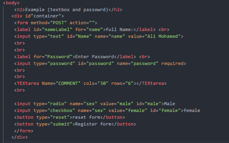
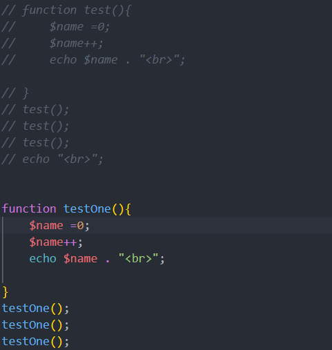
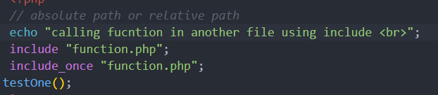

# Week Four Screenshots

This folder contains screenshots of the PHP examples in Week Four. Each section describes the screenshot using its exact filename.

## `form.png`

Shows the original HTML form example with a full-name textbox, password input, comment textarea, radio input, checkbox input, reset button, and submit button. The updated `../form.php` expands these controls to include the form examples covered before the “Upload Files in PHP” slide, and demonstrates how PHP reads submitted values using `$_POST`.

## `functionTest.png`

Shows the `testOne()` function definition. The function creates a local variable named `$name`, increments it, and prints it. The function is called three times. Since `$name` is initialized to `0` every time the function runs, each call prints `1`.

## `include.png`

Shows an example of including `function.php` from another PHP file. It uses `include` and `include_once`, then calls `testOne()`. The related `../index.php` file contains this include example.

## Related PHP Files

- [`../form.php`](../form.php) — form controls and handling submitted form data.
- [`../function.php`](../function.php) — user-defined function example.
- [`../index.php`](../index.php) — including a PHP file.
