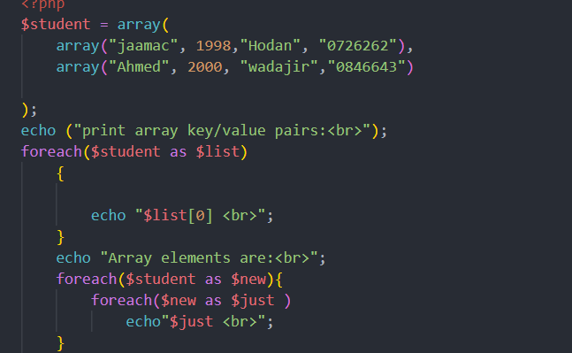
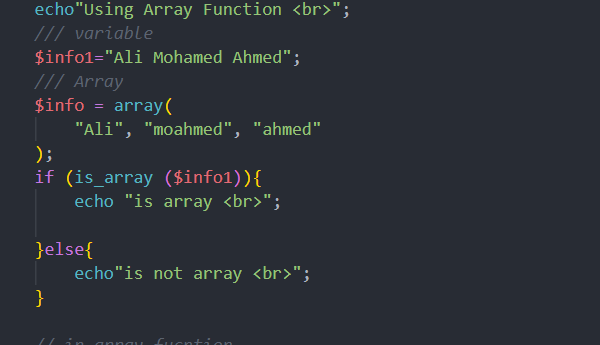
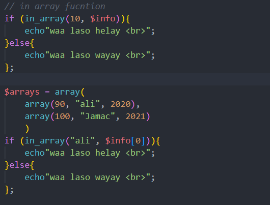
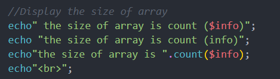

# Week Three 

This folder contains screenshots of practical examples from Chapter 3: Arrays and Functions in PHP. Each entry below uses the screenshot's exact filename.

## `Array.png`

Shows the `$student` multidimensional array. Each student is stored as an inner array containing details such as name, year, district, and phone number. The screenshot demonstrates one `foreach` loop to display the first item in each student record and nested `foreach` loops to display every value.

## `ArrayFunction.png`

Shows the `is_array()` function being used to check whether a variable is an array. The example compares a string variable with an array variable and displays a message depending on the result.

## `InArrayFunction.png`

Shows `in_array()` checks. The first check searches for a value in a regular array. The second check searches for `"ali"` inside an inner array from a multidimensional array. It demonstrates checking whether a value exists before displaying a result.

## `TheSizeOfArray.png`

Shows an attempt to display an array's size. The relevant concept is `count()`, which returns the number of elements in an array. The correct form in the example is to concatenate the result of `count($info)` into the output string.

## `Screenshot 2026-10-15 211011.png`

This screenshot lists four array-function examples that still need to be completed in the PHP practice file: `shuffle`, `explode`, `merge`, and `reverse`. The completed `MultiDimensional.php` file now includes examples for `shuffle()`, `explode()`, `array_merge()`, and `array_reverse()`.

## Related PHP File

See [`../MultiDimensional.php`](../MultiDimensional.php) for the corresponding examples in one PHP file.
